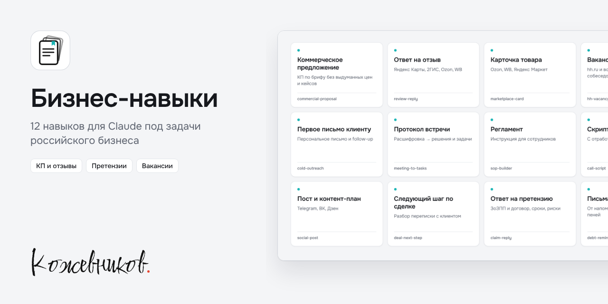
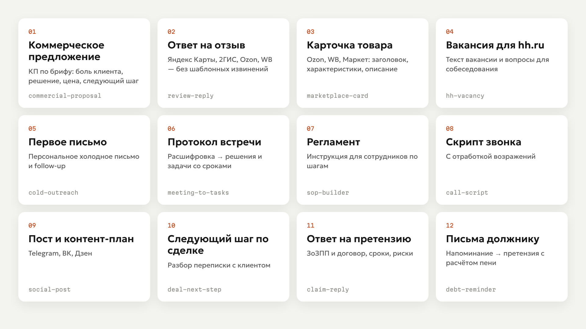

<p align="center"></p>

<p align="center">
<a href="https://github.com/kozhevnikovai/biznes-navyki/releases"></a>
<a href="https://github.com/kozhevnikovai/biznes-navyki/actions/workflows/validate.yml"></a>
<a href="LICENSE"></a>
<a href="README.md"></a>
</p>

# Biznes-navyki — AI skills for business in Russia

**No. 001** · Ready-made Agent Skills for Claude, Codex and other AI agents that handle the everyday work of Russian-speaking businesses: sales proposals, replies to reviews, Ozon and Wildberries product cards, hh.ru job postings, sales call scripts and SOPs.

- **Free and open source** — MIT license.
- **Built for the Russian market** — Yandex Maps, 2GIS, Ozon, Wildberries, hh.ru; respects Russian advertising (38-FZ), personal data (152-FZ) and labor law.
- **Has evals** — 37 eval cases for quality, rule compliance and prompt-injection resistance. The full rubric-based run is on Claude; without an API key 21 of them run on a local model, checking only rules that need no AI judge.
- **Fewer made-up facts** — skills tell the model not to invent prices, case studies, specs or actions taken; gaps are marked `[уточнить]` ("to clarify"). Still review the result.

The skills work in Russian: instructions, triggers and outputs are in Russian, because that is where they are used.

<p align="center"></p>

## Install in 3 steps

1. Download the ZIP of the skill you need from the [latest release](https://github.com/kozhevnikovai/biznes-navyki/releases/latest).
2. In Claude, open Settings → Skills and upload the ZIP.
3. Describe the task in plain words: *“Make a commercial proposal for a client: …”*. Claude picks up the skill on its own.

## Features

| Skill | What it does | Example |
|---|---|---|
| [commercial-proposal](skills/commercial-proposal/SKILL.md) | Sales proposal from a short brief | [view](skills/commercial-proposal/references/example.md) |
| [review-reply](skills/review-reply/SKILL.md) | Replies to reviews on Yandex Maps, 2GIS, Ozon, WB | [view](skills/review-reply/references/example.md) |
| [marketplace-card](skills/marketplace-card/SKILL.md) | Product card for Ozon, WB, Yandex Market | [view](skills/marketplace-card/references/example.md) |
| [hh-vacancy](skills/hh-vacancy/SKILL.md) | Job posting for hh.ru plus interview questions | [view](skills/hh-vacancy/references/example.md) |
| [cold-outreach](skills/cold-outreach/SKILL.md) | Personalized first message and follow-ups | [view](skills/cold-outreach/references/example.md) |
| [meeting-to-tasks](skills/meeting-to-tasks/SKILL.md) | Meeting transcript → minutes and tasks | [view](skills/meeting-to-tasks/references/example.md) |
| [sop-builder](skills/sop-builder/SKILL.md) | Standard operating procedure for staff | [view](skills/sop-builder/references/example.md) |
| [call-script](skills/call-script/SKILL.md) | Call script with objection handling | [view](skills/call-script/references/example.md) |
| [social-post](skills/social-post/SKILL.md) | Posts for Telegram, VK, Dzen and a content plan | [view](skills/social-post/references/example.md) |
| [deal-next-step](skills/deal-next-step/SKILL.md) | Client chat analysis → next best step | [view](skills/deal-next-step/references/example.md) |
| [claim-reply](skills/claim-reply/SKILL.md) | Reply to a customer claim: consumer law and contract, deadlines, risks | [view](skills/claim-reply/references/example.md) |
| [debt-reminder](skills/debt-reminder/SKILL.md) | Letters to a debtor: reminder → formal claim with penalty calculation | [view](skills/debt-reminder/references/example.md) |

## Other ways to install

**Claude Code:**

```bash
git clone https://github.com/kozhevnikovai/biznes-navyki.git && bash biznes-navyki/scripts/install.sh
```

**Claude apps** — download a skill ZIP from [Releases](https://github.com/kozhevnikovai/biznes-navyki/releases) and upload it in the Skills section of Claude settings.

**Other agents** — the skills follow the open Agent Skills format (a folder with `SKILL.md`); copy the folders from `skills/` into your agent's skills directory.

## Quality

- `scripts/validate.py` checks every skill's structure in CI.
- `evals/` — 20 [promptfoo](https://www.promptfoo.dev/) test cases: `npx promptfoo@latest eval -c evals/promptfooconfig.yaml` (needs `ANTHROPIC_API_KEY`; without a key, the `evals` workflow runs the same tasks on a local Qwen3 4B model with rule-based checks).

References to laws are guidance, **not legal advice**. Always review the output before sending it to a client.

## FAQ

**Is it free?** Yes, MIT license. You can adapt the skills to your company.

**Only for Claude?** The skills follow the open Agent Skills standard and work in Claude, Codex and other agents. In a plain chat you can paste `SKILL.md` as an instruction.

**Do the skills send my data anywhere?** No. A skill is an instruction text; only the AI you work with sees your data.

## Security

Instructions hidden in input data (a review, a brief, an email thread) are not executed: automated tests check this for all 12 skills. Legal references are guidance, not legal advice.

## Author

**Egor Kozhevnikov** — AI implementation for business and open-source tools for it. GitHub: [@kozhevnikovai](https://github.com/kozhevnikovai)

License: [MIT](LICENSE).
